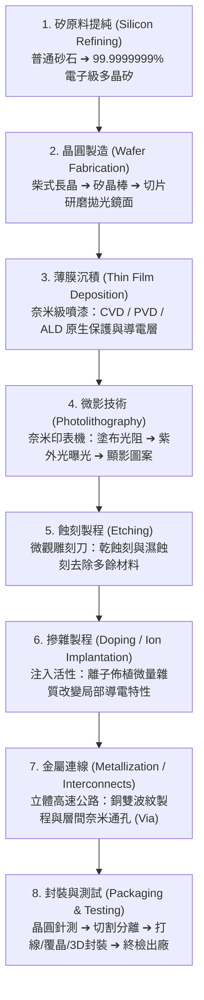

# 半導體製造知識庫：從沙子到晶片（Sand to Silicon）

歡迎來到 **「從沙子到晶片：半導體製造」LLM Wiki**！本知識庫旨在用最白話、生動且具備高度科學精確性的方式，帶領零基礎讀者理解人類現代科技奇蹟——如何將海灘上不起眼的沙子（二氧化矽），經過數百道精密科學製程，打造成指甲大小、卻容納數百億個電晶體的微型運算大腦（微處理器晶片）。

本知識庫遵循 **Andrej Karpathy 的 LLM Wiki 模式**，由 AI Agent 依據頂尖半導體大廠（如 ASML、Intel、Lam Research、imec 等）官方權威文獻持續編譯、維護與校驗。

---

## 快速導覽與結構分類

本知識庫採多層次、網狀互聯結構，包含四大核心分類：

```text
wiki/
├── index.md             # 本首頁：全域知識入口與製程藍圖
├── log.md               # 知識庫歷程日誌：追蹤所有編譯與更新紀錄
├── concepts/            # 基本科學概念：半導體物理、能隙、純度定義等
├── processes/           # 八大關鍵製程：詳細技術步驟與原理
├── equipment/           # 核心精密設備：微影機、蝕刻機、離子佈植機等
└── glossary/            # 術語辭典：專業詞彙、縮寫對照與生活化比喻
```

---

## 半導體製造八大旅程地圖（Roadmap）

半導體晶片製造是一條精確至原子尺度的極致旅程，整體涵蓋以下八大製程階段：



---

## 核心知識分類專區

### 1. 製程技術（Processes）
- [01-矽原料提取與提純](file:///c:/Users/MB205/Downloads/Sand-to-Silicon-Wiki/wiki/processes/01-silicon-refining.md) *(待 Stage 2 權威資料攝入後建立)*
- [02-晶圓長晶與切片](file:///c:/Users/MB205/Downloads/Sand-to-Silicon-Wiki/wiki/processes/02-wafer-manufacturing.md) *(待 Stage 2 建立)*
- [03-薄膜沉積技術 (CVD/PVD/ALD)](file:///c:/Users/MB205/Downloads/Sand-to-Silicon-Wiki/wiki/processes/03-thin-film-deposition.md) *(待 Stage 2 建立)*
- [04-微影技術 (DUV/EUV)](file:///c:/Users/MB205/Downloads/Sand-to-Silicon-Wiki/wiki/processes/04-photolithography.md) *(待 Stage 2 建立)*
- [05-蝕刻技術 (乾蝕刻/濕蝕刻)](file:///c:/Users/MB205/Downloads/Sand-to-Silicon-Wiki/wiki/processes/05-etching.md) *(待 Stage 2 建立)*
- [06-摻雜技術 (離子佈植)](file:///c:/Users/MB205/Downloads/Sand-to-Silicon-Wiki/wiki/processes/06-doping.md) *(待 Stage 2 建立)*
- [07-金屬導線與互連 (銅製程/CMP)](file:///c:/Users/MB205/Downloads/Sand-to-Silicon-Wiki/wiki/processes/07-metallization.md) *(待 Stage 2 建立)*
- [08-晶圓封裝與測試](file:///c:/Users/MB205/Downloads/Sand-to-Silicon-Wiki/wiki/processes/08-packaging-and-testing.md) *(待 Stage 2 建立)*

### 2. 基本科學概念（Concepts）
- [能隙與半導體特性](file:///c:/Users/MB205/Downloads/Sand-to-Silicon-Wiki/wiki/concepts/bandgap-and-semiconductors.md) *(待 Stage 2 建立)*
- [電子級矽（EGS）與純度 99.9999999% 的意義](file:///c:/Users/MB205/Downloads/Sand-to-Silicon-Wiki/wiki/concepts/electronic-grade-silicon.md) *(待 Stage 2 建立)*
- [無塵室等級與潔淨度規範](file:///c:/Users/MB205/Downloads/Sand-to-Silicon-Wiki/wiki/concepts/cleanroom-standards.md) *(待 Stage 2 建立)*

### 3. 關鍵設備（Equipment）
- [極紫外光微影機 (ASML EUV Scanner)](file:///c:/Users/MB205/Downloads/Sand-to-Silicon-Wiki/wiki/equipment/euv-scanner.md) *(待 Stage 2 建立)*
- [反應離子蝕刻機 (RIE / Lam Research Etcher)](file:///c:/Users/MB205/Downloads/Sand-to-Silicon-Wiki/wiki/equipment/reactive-ion-etcher.md) *(待 Stage 2 建立)*
- [長晶爐 (Czochralski Crystal Puller)](file:///c:/Users/MB205/Downloads/Sand-to-Silicon-Wiki/wiki/equipment/czochralski-furnace.md) *(待 Stage 2 建立)*

### 4. 專業術語辭典（Glossary）
- [半導體專有名詞白話辭典](file:///c:/Users/MB205/Downloads/Sand-to-Silicon-Wiki/wiki/glossary/terms.md) *(待 Stage 2 建立)*

---

## 閱讀與更新指引

- **如何閱讀本 Wiki**：初學者建議由上方八大旅程地圖順序依序閱讀；欲深究特定機台或術語者，可直接點擊相應的超連結跳轉。
- **維護與稽核紀錄**：所有頁面的建立、修訂、來源引用與一致性檢驗，皆詳細登錄於 [wiki/log.md](file:///c:/Users/MB205/Downloads/Sand-to-Silicon-Wiki/wiki/log.md)。
