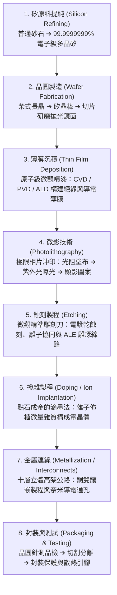

# 半導體製造知識庫：從沙子到晶片（Sand to Silicon）

歡迎來到 **「從沙子到晶片：半導體製造」LLM Wiki**！本知識庫旨在用最通俗易懂的語言與生動的生活比喻，輔以高度科學精確性，帶領讀者深入探索人類最先進的科技奇蹟——如何將海灘上隨處可見的沙子（二氧化矽），透過數百道精密科學製程，打造成指甲大小、卻容納數百億個電晶體的微型運算大腦（微處理器晶片）。

本專案依循 **Andrej Karpathy 的 LLM Wiki 模式**，由 AI Agent 依據 ASML (SRC-001)、imec (SRC-002) 以及 Lam Research (SRC-003, SRC-004) 等頂尖官方權威文獻，持續進行知識編譯、關聯交叉鏈結與嚴格查驗。

---

## 半導體製造八大旅程地圖（Roadmap）

半導體晶片製造是一條精確至原子尺度的極致旅程，整體涵蓋以下八大製程階段（點擊可直接跳轉至各製程專頁）：

---

## 核心知識分類專區

### 1. 製程技術（Processes）
八大核心製造流程詳細專頁已全數建置完成，內容涵蓋原理、參數、設備、上下游關聯與白話比喻：
- [01-矽原料提取與提純](processes/01-silicon-refining.md)：從二氧化矽砂石到 99.9999999% 電子級高純度多晶矽。
- [02-晶圓長晶與切片](processes/02-wafer-manufacturing.md)：柴可拉斯基法拉製單晶矽晶棒、線鋸切片與 CMP 拋光成鏡面晶圓。
- [03-薄膜沉積技術](processes/03-thin-film-deposition.md)：化學氣相沉積（CVD）、物理氣相沉積（PVD）、電化學沉積（ECD）與原子層沉積（ALD）。
- [04-微影技術](processes/04-photolithography.md)：光阻塗布、光罩對準、DUV 與 ASML EUV 極紫外光曝光顯影。
- [05-蝕刻製程](processes/05-etching.md)：等向性濕蝕刻與非等向性電漿乾蝕刻、離子-中性粒子協同效應（Ion-Neutral Synergy）與原子層蝕刻（ALE）。
- [06-摻雜技術與電晶體構建](processes/06-doping.md)：離子佈植打入磷與硼雜質，建立 P 型/N 型區域與電晶體閘極。
- [07-金屬導線與層間互連](processes/07-metallization.md)：銅雙鑲嵌製程（Dual Damascene）與十餘層立體奈米高速公路互連。
- [08-晶圓封裝與測試](processes/08-packaging-and-testing.md)：晶圓針測（CP）、晶粒切割、打線覆晶封裝與散熱出廠。

### 2. 基本科學概念（Concepts）
- [微晶片與積體電路基礎](concepts/microchip-basics.md)：什麼是晶片？電晶體開關原理、半導體特性、邏輯與記憶體晶片分類。
- [奈米微觀尺度與摩爾定律](concepts/nanoscale-and-moore.md)：1 奈米有多小？指甲生長比喻、微觀物理極限與摩爾定律發展史。
- [無塵室與半導體製造環境](concepts/cleanroom-standards.md)：為什麼微塵是晶片的致命殺手？層流氣流、防塵衣與潔淨度規範。

### 3. 專業術語辭典（Glossary）
- [半導體核心術語與生活化比喻辭典](glossary/terms.md)：完整收錄晶圓、光罩、光阻、EUV、CVD、RIE、CMP、SoC 等關鍵詞彙的繁體中文解釋與直覺比喻。

---

## 閱讀指引與資料來源追溯

- **初學者建議路徑**：建議先閱讀 [微晶片與積體電路基礎](concepts/microchip-basics.md) 了解電晶體與晶片概觀，再依序瀏覽八大製程技術（從 01 至 08）。遇到生疏名詞可隨時查閱 [術語辭典](glossary/terms.md)。
- **不可變原始來源清單**：本知識庫所有事實陳述皆能精確溯源至 [sources/manifest.json](file:///c:/Users/MB205/Downloads/Sand-to-Silicon-Wiki/sources/manifest.json) 中的官方權威文獻（本批次：ASML `SRC-001` 與 imec `SRC-002`）。
- **歷程更新日誌**：每次 Wiki 頁面的增修與演進，皆忠實記錄於 [wiki/log.md](log.md)。
