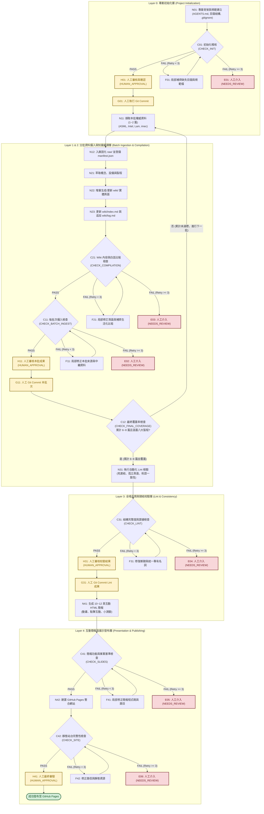

# Workflow Graph: 半導體製造 LLM Wiki 分層執行流程圖

> [!IMPORTANT]
> **設計規格與實際執行之區分聲明**：
> 本文件為專案的**設計規格（Design Specification）與架構藍圖**，流程圖的存在絕不等於所有節點已經實際執行完畢。後續 Ingest、Query、Lint、Slides 與 Deployment 各階段必須依序推進，每次執行皆必須產出真實且可驗證之執行紀錄與證據檔案。

本系統採用**具備局部小迴圈的有向工作流程圖（Directed Workflow Graph with Localized Cycles）**，嚴格規範每一分層的執行步驟、獨立檢查節點、失敗局部修正、人工審核關卡（Human Approval Gate）與停止條件。

---

## 一、Workflow Graph 視覺化流程圖

---

## 二、節點詳細定義（Node Specifications）

### Layer 0: 專案初始化層
- **N01: 專案骨架與規範建立**
  - **輸入**: 使用者需求、Karpathy LLM Wiki 構想藍圖。
  - **輸出**: `AGENTS.md`, `README.md`, `wiki/index.md`, `wiki/log.md`, `workflow/graph.md`, `.gitignore`, 必要目錄。
  - **關聯檢查節點**: `C01 (CHECK_INIT)`。
- **C01: 初始化稽核 (CHECK_INIT)**
  - **檢驗條件**: 目錄完整性、規範完備度、.gitignore 有效性、真實執行紀錄。
  - **處置**: 通過後進入 `H01 (HUMAN_APPROVAL)`；失敗進入 `F01`，最多重試 3 次。
- **H01: 人工審核與確認 (HUMAN_APPROVAL)**
  - **說明**: 人工檢查 Stage 1 成果，確認無誤後授權進入版本控制。
- **G01: 人工執行 Git Commit**
  - **說明**: 由人類執行 `git commit`。未經人工同意，嚴禁自動開始 Ingest。

---

### Layer 1: 分批權威資料攝入層
- **N11: 本批官方文獻擷取（入庫前）**
  - **輸入**: ASML, Intel, Lam Research, imec 官方公開資料（每批 1～2 篇）。
  - **輸出**: 暫存擷取文字與中繼資料，確認內容真實性無誤。
- **N12: 入庫固化與登錄 Manifest（入庫後）**
  - **輸入**: 驗證後之原始內容。
  - **輸出**: 存入 `raw/`（從此不可變更或覆寫），計算 SHA256 並登錄於 `sources/manifest.json`。
- **C11: 每批次攝入檢查 (CHECK_BATCH_INGEST)**
  - **檢驗條件**:
    1. 本批來源真實性與官方權威性確認。
    2. 原始文檔讀取完整性與 SHA256 Checksum 一致性。
    3. `sources/manifest.json` 登錄欄位齊全無訛。
    4. 本批對應之 Wiki 頁面增量編譯完成且包含生活化比喻。
  - **處置**: PASS 進入 `H11 (HUMAN_APPROVAL)`；FAIL 進入 `F11` 局部修正（最多 3 次）。
- **H11: 人工審核本批成果 (HUMAN_APPROVAL)**
  - **說明**: 人工檢閱本批次新增之 `raw/`、`sources/` 與 `wiki/` 內容。
- **G11: 人工執行 Git Commit 本批次**
  - **說明**: 人工提交本批異動紀錄，完成該批次固化。
- **C12: 最終覆蓋率檢查 (CHECK_FINAL_COVERAGE)**
  - **檢驗條件**:
    1. 累計攝入權威來源篇數達 6～8 篇。
    2. 八大關鍵製程（矽原料、晶圓、薄膜、微影、蝕刻、摻雜、金屬連線、封測）皆有權威文獻支撐。
  - **處置**: 達標則進入 Layer 3 全域校驗；未達標則循環返回 `N11` 進行下一批攝入。

---

### Layer 2: Wiki 知識編譯層
- **N21: 概念與製程提取**
  - **輸入**: 本批次 `raw/` 資料。
  - **輸出**: 結構化概念草稿。
- **N22: Wiki Markdown 實體生成/增量更新**
  - **輸入**: 提取內容與現有 `wiki/` 頁面。
  - **輸出**: `wiki/concepts/`, `wiki/processes/`, `wiki/equipment/`, `wiki/glossary/` 之 Markdown 檔案。
- **N23: 索引與歷程登錄**
  - **輸入**: 本次異動頁面。
  - **輸出**: 更新 `wiki/index.md` 並追加至 `wiki/log.md`。
- **C21: Wiki 內容與白話比喻檢查 (CHECK_COMPILATION)**
  - **檢驗條件**: Frontmatter 合規性、白話比喻存在性、英文術語保留、事實精確溯源。
  - **處置**: PASS 進入 `C11`；FAIL 進入 `F21` 局部修正（最多 3 次）。

---

### Layer 3: 全域品質與鏈結校驗層
- **N31: 執行自動化 Lint 檢驗**
  - **輸入**: `wiki/` 所有檔案。
  - **輸出**: 檢驗報告儲存於 `evidence/lint/lint_report.md`。
- **C31: 結構完整度與證據檢查 (CHECK_LINT)**
  - **檢驗條件**:
    1. **死連結 (Broken Links)**: 0 處斷鏈。
    2. **孤立頁面 (Orphan Pages)**: 0 個孤立頁面。
    3. **術語一致性**: 全專案專有名詞繁體中文統一度 100%。
    4. **證據保存**: `evidence/lint/` 內具備實際比對檢驗紀錄。
  - **處置**: PASS 進入 `H31` 審核與 `G31` Commit；FAIL 進入 `F31` 局部修正（最多 3 次）。

---

### Layer 4: 互動簡報與展示發布層
- **N41: 互動 HTML 簡報生成**
  - **輸入**: `wiki/` 知識庫。
  - **輸出**: 放置於 `website/slides/` 的 10～12 頁純前端互動網頁。
- **C41: 簡報功能與事實基準檢查 (CHECK_SLIDES)**
  - **檢驗條件**: 頁數符合 10～12 頁、具備動畫、互動展開、進度條、小測驗，且文案與 `wiki/` 一致無幻覺。
  - **處置**: PASS 進入 `N42`；FAIL 進入 `F41` 局部修正（最多 3 次）。
- **N42: GitHub Pages 整合發布**
  - **輸入**: `website/`, `wiki/`, `workflow/graph.md`, `logs/`。
  - **輸出**: 靜態發布站台包。
- **C42: 靜態站台完整性檢查 (CHECK_SITE)**
  - **檢驗條件**: 資源載入無 404、跨裝置響應式支援良好。
  - **處置**: PASS 進入 `H41` 人工最終驗收；FAIL 進入 `F42` 局部修正（最多 3 次）。

---

## 三、失敗返回路徑、局部重試與審計紀錄矩陣

所有節點均嚴格遵守**局部修正原則（Local Patch）**與**嚴謹重試紀錄規範**：

1. **最大修正嘗試次數**：單一檢查節點失敗後，局部修正小迴圈**最多允許 3 次嘗試**（RetryCount: 1, 2, 3）。
2. **實質重新執行與查驗**：每次局部修正後，**必須重新執行與該問題相關之操作及檢查，嚴禁未經操作直接將狀態改為 PASS**。
3. **重試必須記錄之 7 大稽核項目**：
   - 發生錯誤的節點 (Failed Node)
   - 錯誤原因 (Error Reason)
   - 修正前內容 (Before Fix)
   - 修正動作 (Fix Action)
   - 修正後結果 (After Fix Result)
   - 重試次數 (Retry Count)
   - 實際驗證證據 (Actual Verification Evidence)
4. **連續三次失敗終止**：連續 3 次修正後若仍未通過，狀態自動轉為 `NEEDS_REVIEW`，流程即刻停止並輸出問題診斷報告，等待人類確認。

| 檢查節點 | 判定結果 | 返回目標節點 | 修正範圍 (Scope) | 最大重試 | 升級條件 |
| :--- | :---: | :--- | :--- | :---: | :--- |
| **C01 (CHECK_INIT)** | `FAIL` | `F01` ➔ `C01` | 局部補齊缺漏之目錄、規範檔案或格式 | 3 次 | 超過 3 次轉為 `NEEDS_REVIEW` |
| **C11 (CHECK_BATCH_INGEST)** | `FAIL` | `F11` ➔ `C11` | 局部替換不合規來源、重新校驗 Checksum 與 Manifest | 3 次 | 超過 3 次轉為 `NEEDS_REVIEW` |
| **C12 (CHECK_FINAL_COVERAGE)**| 未達標 | `N11` ➔ `C12` | 規劃並進行下一批次官方文獻攝入 | 無（批次推進）| 達 8 篇仍缺製程轉 `NEEDS_REVIEW` |
| **C21 (CHECK_COMPILATION)** | `FAIL` | `F21` ➔ `C21` | 局部編修特定 Markdown 頁面或補齊白話比喻 | 3 次 | 超過 3 次轉為 `NEEDS_REVIEW` |
| **C31 (CHECK_LINT)** | `FAIL` | `F31` ➔ `C31` | 局部修補超連結路徑或專有名詞對照表 | 3 次 | 超過 3 次轉為 `NEEDS_REVIEW` |
| **C41 (CHECK_SLIDES)** | `FAIL` | `F41` ➔ `C41` | 局部微調特定 Slide 的互動邏輯、事實定義或試題 | 3 次 | 超過 3 次轉為 `NEEDS_REVIEW` |
| **C42 (CHECK_SITE)** | `FAIL` | `F42` ➔ `C42` | 局部修復靜態資源路徑引用 | 3 次 | 超過 3 次轉為 `NEEDS_REVIEW` |

---

## 四、後續階段可實際執行之檢查方式規劃（Specification）

為落實真實查驗而非形式化宣稱，後續各階段規劃以下具體之自動化/半自動化檢查方式（本階段僅規劃規格，後續依階段實作）：

### 1. Markdown Frontmatter 與來源 ID 驗證
- **查驗方式**: 使用 Python/PowerShell 腳本解析 `wiki/` 內所有 Markdown 的 YAML Frontmatter。
- **查驗指標**:
  - 必要鍵值（`title`, `category`, `sources`, `last_updated`, `prerequisites`, `related_pages`）不得缺漏。
  - `sources` 列表中列出的每一筆 ID，必須能在 `sources/manifest.json` 中找到相應的登記紀錄。

### 2. Markdown 相對連結與檔案存在性檢查
- **查驗方式**: 正則表達式掃描所有 `[文字](相對路徑.md)` 連結。
- **查驗指標**:
  - 根據當前檔案所在目錄解析相對路徑，確認目標檔案於檔案系統中真實存在。
  - 死連結數量必須為 0。

### 3. Wiki 頁面及索引一致性檢查
- **查驗方式**: 雙向對照稽核：
  - 正向：檢查 `wiki/index.md` 中所引用的所有頁面是否皆真實存在。
  - 反向：檢查 `wiki/` 下所有的實體頁面（除 `index.md` 與 `log.md` 外），是否至少被 `index.md` 或其他頁面引用一次，確保孤立頁面（Orphan Pages）數量為 0。

### 4. 資料來源覆蓋率矩陣檢查
- **查驗方式**: 建立八大關鍵製程與 `sources/manifest.json` 的對映矩陣。
- **查驗指標**:
  - 矽原料、晶圓製造、薄膜沉積、微影、蝕刻、摻雜、金屬連線、封裝測試等八大領域，每項至少有一篇權威文獻對應，總篇數介於 6～8 篇。

### 5. HTML 簡報功能及 Wiki 事實忠實度檢查
- **查驗方式**:
  - DOM 結構檢查：驗證 `website/slides/` 頁數介於 10～12 頁，且具備進度條、切換鍵與測驗節點。
  - 事實忠實度交叉比對：抽驗簡報中的技術數值與專有名詞解釋，確認與 `wiki/` 內容完全相符，無額外臆測或矛盾。
